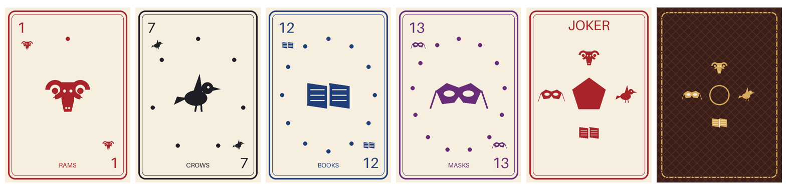

# Card decks: making and uploading your own

Dice Familiar plays with the standard decks (36, 52 or 54 cards), with custom decks you pick from the 54 standard cards, and with **your own decks**, uploaded in **Settings → Cards → Upload deck**. An uploaded deck can have **up to 1000 cards**.



## Contents
- [Three ways to make a deck](#three-ways-to-make-a-deck)
- [1. ZIP with a CSV and images](#1-zip-with-a-csv-and-images)
- [2. ZIP of images only](#2-zip-of-images-only)
- [3. A plain CSV](#3-a-plain-csv)
- [Image requirements](#image-requirements)
- [Limits and safety](#limits-and-safety)
- [Examples](#examples)
- [Checklist](#checklist)

## Three ways to make a deck

| You have | Upload | Cards look like |
|---|---|---|
| Card art plus names and values | **ZIP with `cards.csv` and images** | your images (cards without an image are drawn as text) |
| Card art only | **ZIP of images** | your images; the names come from the file names |
| Just a list | **CSV file** | text cards: value in the corner, name and suit in the middle |

The uploaded deck appears in the deck list (the cards icon at the top left of the Cards tab) and is selected straight away. Every deck can be deleted in Settings → Cards or in the deck list.

## 1. ZIP with a CSV and images

```
my_deck.zip
├── cards.csv      the card list, in deck order
├── back.png       optional: the card back
└── images/
    ├── rams_01.png
    └── crows_13.png
```

`cards.csv` (any `.csv` at the top of the ZIP) is UTF-8, comma-separated, with standard quoting (`"Card, with comma"`, `""` for a quote):

```csv
name,value,suit,image
1 of Rams,1,Rams,images/rams_01.png
13 of Crows,13,Crows,images/crows_13.png
Red Joker,Joker,,images/joker_red.png
```

| Column | Required | Meaning |
|---|---|---|
| `name` | one of name / value / image | Shown in the full-screen view and read by screen readers. If empty, it is built from value + suit, or from the image file name. |
| `value` | no | Corner label of text cards (`7`, `K`, `XIII`, `Joker`). |
| `suit` | no | Shown under the name on text cards. `♥` and `♦` are drawn in red. |
| `image` | no | Path inside the ZIP. A missing image is reported after the upload; that card becomes a text card. |

- The header row is optional; without it the columns are read as `name,value,suit,image`. With it, the columns can be in any order.
- Blank lines are skipped. The deck keeps the CSV's order (the table shuffles it anyway).
- The same image can be used by several rows.

## 2. ZIP of images only

```
runes.zip
└── runes/                 one top-level folder is fine
    ├── 01_sun.png         → card "01 sun"
    ├── 02_moon.png        → card "02 moon"
    └── …
```

- One card per image, in **natural file-name order** (`card2` before `card10`).
- The name is the file name without extension; `_` and `-` become spaces.
- `back.png` / `back.jpg` / `back.webp` at the top is the card back, not a card.

## 3. A plain CSV

Upload the `.csv` file itself (same columns as above). The `image` column is ignored, so every card is a text card.

```csv
name,value,suit
The Fool,0,Major Arcana
The Magician,I,Major Arcana
```

## Image requirements

- **Format:** PNG, JPG or WebP.
- **Shape:** portrait **5 : 7** (playing-card proportions 63 × 88 mm), e.g. **500 × 700 px**. Other shapes are cropped to fill the card.
- **Size:** larger than 1024 px on the long side is scaled down on upload; 500 × 700 is plenty on phones.
- **Design:** keep important details ~6 % away from the edges (cards have rounded corners), and put the value in a corner so cards read when fanned in the hand.
- **Back:** `back.png` at the top of the ZIP, same shape. Without it, the back follows the app theme.

## Limits and safety

- At most **1000 cards** per deck (more is rejected with a clear message).
- ZIP: at most 1200 entries, **200 MB** unpacked, **10 MB per image**, **1 MB per CSV**.
- Other files (notes, fonts, …) are skipped and counted in the upload message.
- Paths with `..` or absolute paths are rejected (zip-slip). Everything is unpacked in the app's private storage.
- The upload is all-or-nothing: a failed upload leaves no partial deck behind.

## Examples

Generated by [`tools/gen_card_examples.py`](../tools/gen_card_examples.py) (original artwork; rerunning gives identical files) and checked by `CardExamplesTest`:

| File | Kind | What it shows |
|---|---|---|
| [`omens.zip`](card-examples/omens.zip) | ZIP: CSV + images + back | A 54-card fantasy deck with four suits — **Rams** (in place of hearts), **Crows** (spades), **Books** (clubs), **Masks** (diamonds) — values 1–13 and two jokers. |
| [`runes.zip`](card-examples/runes.zip) | ZIP: images only | 16 rune cards named from their files. |
| [`tarot-major.csv`](card-examples/tarot-major.csv) | plain CSV | The 22 Major Arcana as text cards. |

Try one: `adb push docs/card-examples/omens.zip /sdcard/Download/`, then Settings → Cards → Upload deck.

## Checklist
1. All cards in one shape (5 : 7), each under 10 MB.
2. `cards.csv` lists every card you want, in order, with `image` paths matching the ZIP (case doesn't matter).
3. Optional `back.png` at the top of the ZIP.
4. At most 1000 cards.
5. Zip the folder (one wrapper folder is fine) and upload it in Settings → Cards.
