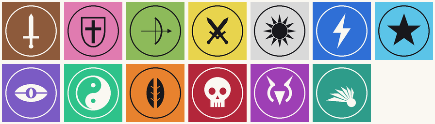

# Pools: import, export and display

A **pool** is a named list of items to pick from. Each item has a **name** (unique in the pool), an optional **image** and an optional **colour**. Items can be added one by one in **Edit pool**, or imported from a **CSV** or a **ZIP**.



## Contents
- [CSV](#csv)
- [ZIP with images](#zip-with-images)
- [Import rules](#import-rules)
- [Export](#export)
- [How items look](#how-items-look)
- [Examples](#examples)

## CSV
UTF-8, comma-separated, with standard RFC 4180 quoting (`"Apple, red"`, `""` for a quote).

```csv
name,image,color
Apple,images/apple.png,#E53935
Banana,images/banana.jpg,#FDD835
Cherry,,#8E24AA
```

| Column | Required | Meaning |
|---|---|---|
| `name` | yes | The item's name. Rows without one are skipped. |
| `image` | no | A path inside the ZIP. **Ignored for a plain CSV.** |
| `color` | no | `#RRGGBB` or `#AARRGGBB`. Anything else is ignored. |

- The header row is optional. Without it, the columns are read as `name,image,color`. With it, they can be in any order, and `name,color` (a CSV export) works too.
- Blank lines are skipped.

## ZIP with images
```
pool.zip
├── items.csv        required, at the top of the ZIP (one wrapper folder is fine)
└── images/          optional; the files the CSV "image" column points to
    ├── apple.png
    └── banana.jpg
```

- **Images:** PNG, JPG/JPEG or WebP, at most **10 MB each**. Images larger than 1024 px are scaled down.
- **Image paths** are relative to the top of the ZIP. Case doesn't matter.
- **Safety:** paths with `..` and absolute paths are rejected (zip-slip). The limits are **1000 files** and **200 MB** unpacked, and nothing is extracted outside the app's cache.

## Import rules
- **Extend or Replace:** after the file is read, a dialog shows how many items and images it holds. **Extend** adds them after the current items; **Replace** swaps the current items out.
- **Duplicate names** get ` #N`, with the smallest free N ≥ 2. This covers names already in the pool and names earlier in the same file: `Apple`, `Apple #2`, `Apple #3`.
- **A missing, unsupported or oversized image:** the item is imported without it, and the snackbar counts it as skipped.
- **All or nothing:** if the file can't be read, has no items, or a ZIP has no `items.csv`, the pool is left unchanged and nothing stays behind.
- **Saving:** the imported items are saved together with the pool when you tap **Save**.
- **Limit:** a pool holds at most **1000 items**.

## Export
**Edit pool → Export** (disabled for an empty pool). **Save** writes a file; **Share** sends it to another app.

- **No item has an image:** a CSV with `name,color`.
- **Some items have images:** choose a **ZIP with images** (`items.csv` with `name,image,color`, plus `images/` named after the items) or a **CSV only** (the images are dropped).
- **Round trip:** an exported file imports back with the same names, colours and images.

## How items look
The look is worked out from the **whole pool**, never item by item, and is the same in Edit pool and in the Pick results.

| Pool | Items are shown as |
|---|---|
| No item has an image | **names only**, on the item's colour |
| Some items have an image | **thumbnail + name**; items without one get a neutral placeholder so rows line up |
| Every item has an image, **Show names** on (the default) | **thumbnail + name** |
| Every item has an image, **Show names** off | **images only**; the name stays the image's description for screen readers |

- **Colour:** the item's colour frames its image and fills its name label. The label text is black or white, whichever reads better.
- **Show names** is a switch in Edit pool and on the Pick screen. It can be turned off only when every item has an image.

## Examples
Generated by [`tools/gen_pool_examples.py`](../tools/gen_pool_examples.py) (original artwork; rerunning gives identical files) and checked by `PoolExamplesTest`:

| File | Kind | What it shows |
|---|---|---|
| [`classes.zip`](pool-examples/classes.zip) | ZIP: `items.csv` + images | 13 fantasy character classes (Warrior, Paladin, Hunter, Rogue, Priest, Shaman, Mage, Warlock, Monk, Druid, Death Knight, Demon Hunter, Evoker), each with an emblem and a colour. Try **Show names** off. |
| [`drinks.csv`](pool-examples/drinks.csv) | plain CSV | 24 non-alcoholic drinks with colours, no images: names only. |

Try one: `adb push docs/pool-examples/classes.zip /sdcard/Download/`, then **Pool → + → Import**.
